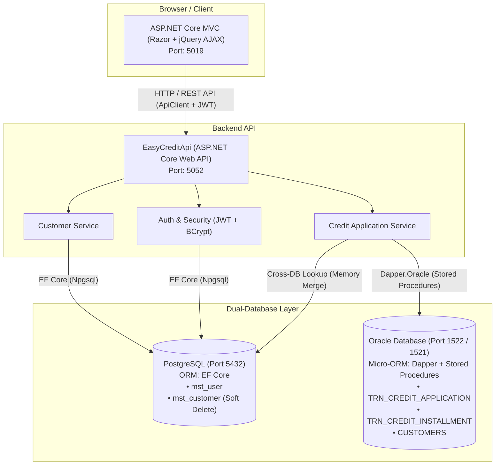

# EasyCredit — Online Credit Application System
> **Bootcamp .NET Batch 19 Final Project**

EasyCredit adalah sistem pengajuan pinjaman/kredit online berbasis **ASP.NET Core** dengan arsitektur **Dual-Database (PostgreSQL & Oracle)** yang memisahkan data master nasabah/otentikasi dan data transaksi finansial secara independen.

---

## 1. Arsitektur Sistem

Aplikasi ini dibangun menggunakan arsitektur modular yang memisahkan Backend API dan Frontend MVC:



### Prinsip Utama Arsitektur:
1. **Pemisahan Database (Dual-Database Isolation):**
   - **PostgreSQL**: Menangani otentikasi pengguna (`mst_user`) dan master data nasabah (`mst_customer`) menggunakan **Entity Framework Core**.
   - **Oracle**: Menangani core engine transaksi kredit (`TRN_CREDIT_APPLICATION`) dan jadwal cicilan (`TRN_CREDIT_INSTALLMENT`) menggunakan **Dapper** dan **Stored Procedures**.
2. **Tanpa Foreign Key Fisik Antar Database (No Cross-DB Foreign Keys):**
   - Tidak ada `DB Link` atau `SQL JOIN` fisik yang menghubungkan tabel PostgreSQL dan Oracle.
   - Integritas relasi `CUSTOMER_ID` divalidasi dan digabungkan (*in-memory merge*) secara eksklusif pada **C# Application Service Layer**.
3. **Soft Delete Nasabah:**
   - Menghapus nasabah di PostgreSQL menggunakan status `is_deleted = TRUE` (Global Query Filter).
   - Memastikan riwayat transaksi kredit masa lalu di Oracle tetap memiliki data profil nasabah yang utuh (jejak audit perbankan/OJK).
4. **Keamanan & Validasi:**
   - **JWT Authentication** dengan role-based access control (`ADMIN` dan `STAFF`).
   - Proteksi **Anti-CSRF (`[ValidateAntiForgeryToken]`)** pada semua mutating request di MVC.
   - Global Exception Handling Middleware yang memetakan error HTTP 400, 401, 403, 404, 409, 500 ke format seragam `ApiResponse<T>`.

---

## 2. Setup Database & Konfigurasi

### A. Konfigurasi Port & Connection Strings

Pengaturan koneksi database dikonfigurasi di file `EasyCreditApi/appsettings.json`:

```json
{
  "ConnectionStrings": {
    "Oracle": "User Id=PEY_NET;Password=peynet;Data Source=localhost:1522/XE",
    "Postgres": "Host=localhost;Port=5432;Database=easycredit;Username=easycredit_user;Password=easycredit_pass"
  },
  "Jwt": {
    "Key": "JwtKunciRahasia2026HarishGanteng",
    "Issuer": "EasyCredit.Api",
    "Audience": "EasyCredit.Client",
    "ExpiryMinutes": 60
  }
}
```

---

### B. Setup PostgreSQL (Port 5432)

Jalankan script SQL berikut pada database PostgreSQL Anda (misal database `easycredit`):

```sql
-- 1. Tabel Master User
CREATE TABLE IF NOT EXISTS mst_user (
    user_id       SERIAL PRIMARY KEY,
    name          VARCHAR(100) NOT NULL,
    email         VARCHAR(100) UNIQUE NOT NULL,
    password_hash VARCHAR(255) NOT NULL,
    role          VARCHAR(20) NOT NULL,
    created_at    TIMESTAMP WITHOUT TIME ZONE DEFAULT NOW()
);

-- 2. Tabel Master Customer (Mendukung Soft Delete)
CREATE TABLE IF NOT EXISTS mst_customer (
    customer_id   SERIAL PRIMARY KEY,
    name          VARCHAR(100) NOT NULL,
    nik           VARCHAR(20) UNIQUE NOT NULL,
    phone         VARCHAR(20),
    email         VARCHAR(100),
    address       VARCHAR(255),
    created_at    TIMESTAMP WITHOUT TIME ZONE DEFAULT NOW(),
    is_deleted    BOOLEAN NOT NULL DEFAULT FALSE
);

-- 3. Seed Pengguna Awal (Password BCrypt)
-- Password Admin: admin123
-- Password Staff: staff123
INSERT INTO mst_user (name, email, password_hash, role)
VALUES 
('Administrator', 'admin@easycredit.test', '$2a$11$qN7jHl7jHwF4F8MvHw6uQeX7G6j9W0Q1X0B7T1G5I8F9K4M5L2P8e', 'ADMIN'),
('Staff Kredit', 'staff@easycredit.test', '$2a$11$vN8jKl8jHwF4F8MvHw6uQeX7G6j9W0Q1X0B7T1G5I8F9K4M5L2P8e', 'STAFF')
ON CONFLICT (email) DO NOTHING;
```

---

### C. Setup Oracle (Port 1522 / 1521, Schema: `PEY_NET`)

Jalankan script SQL berikut di Oracle (Schema `PEY_NET`):

#### 1. DDL Tabel & Sequence
```sql
-- Sequence untuk Auto Increment ID
CREATE SEQUENCE PEY_NET.SEQ_TRN_CREDIT_APP START WITH 1 INCREMENT BY 1 NOCACHE;
CREATE SEQUENCE PEY_NET.SEQ_TRN_CREDIT_INST START WITH 1 INCREMENT BY 1 NOCACHE;
CREATE SEQUENCE PEY_NET.SEQ_CUSTOMERS START WITH 1 INCREMENT BY 1 NOCACHE;

-- Tabel Header Pengajuan Kredit
CREATE TABLE PEY_NET.TRN_CREDIT_APPLICATION (
    APPLICATION_ID    NUMBER PRIMARY KEY,
    CUSTOMER_ID       NUMBER NOT NULL,
    LOAN_AMOUNT       NUMBER(15, 2) NOT NULL,
    TENOR_MONTHS      NUMBER(3) NOT NULL,
    INTEREST_RATE     NUMBER(5, 4) DEFAULT 0.01 NOT NULL,
    CREDIT_SCORE      NUMBER(5) DEFAULT 700,
    STATUS            VARCHAR2(20) DEFAULT 'PENDING' NOT NULL,
    APPLICATION_DATE  DATE DEFAULT SYSDATE NOT NULL,
    APPROVED_BY       VARCHAR2(100),
    APPROVED_DATE     DATE
);

-- Trigger Auto Increment Header
CREATE OR REPLACE TRIGGER PEY_NET.TRG_TRN_CREDIT_APP_BI
BEFORE INSERT ON PEY_NET.TRN_CREDIT_APPLICATION
FOR EACH ROW
BEGIN
    IF :NEW.APPLICATION_ID IS NULL THEN
        SELECT PEY_NET.SEQ_TRN_CREDIT_APP.NEXTVAL INTO :NEW.APPLICATION_ID FROM DUAL;
    END IF;
END;
/

-- Tabel Detail Jadwal Cicilan
CREATE TABLE PEY_NET.TRN_CREDIT_INSTALLMENT (
    INSTALLMENT_ID     NUMBER PRIMARY KEY,
    APPLICATION_ID     NUMBER NOT NULL,
    INSTALLMENT_NO     NUMBER(3) NOT NULL,
    DUE_DATE           DATE NOT NULL,
    INSTALLMENT_AMOUNT NUMBER(15, 2) NOT NULL,
    STATUS             VARCHAR2(20) DEFAULT 'UNPAID' NOT NULL,
    CONSTRAINT FK_INST_APP FOREIGN KEY (APPLICATION_ID) 
        REFERENCES PEY_NET.TRN_CREDIT_APPLICATION (APPLICATION_ID) ON DELETE CASCADE
);

-- Trigger Auto Increment Detail
CREATE OR REPLACE TRIGGER PEY_NET.TRG_TRN_CREDIT_INST_BI
BEFORE INSERT ON PEY_NET.TRN_CREDIT_INSTALLMENT
FOR EACH ROW
BEGIN
    IF :NEW.INSTALLMENT_ID IS NULL THEN
        SELECT PEY_NET.SEQ_TRN_CREDIT_INST.NEXTVAL INTO :NEW.INSTALLMENT_ID FROM DUAL;
    END IF;
END;
/

-- Tabel Pelengkap Demo Customer Oracle
CREATE TABLE PEY_NET.CUSTOMERS (
    ID         NUMBER PRIMARY KEY,
    CUST_NAME  VARCHAR2(100) NOT NULL,
    NIK        VARCHAR2(20) UNIQUE NOT NULL,
    PHONE      VARCHAR2(20),
    EMAIL      VARCHAR2(100),
    ADDRESS    VARCHAR2(255),
    CREATED_AT DATE DEFAULT SYSDATE
);

CREATE OR REPLACE TRIGGER PEY_NET.TRG_CUSTOMERS_BI
BEFORE INSERT ON PEY_NET.CUSTOMERS
FOR EACH ROW
BEGIN
    IF :NEW.ID IS NULL THEN
        SELECT PEY_NET.SEQ_CUSTOMERS.NEXTVAL INTO :NEW.ID FROM DUAL;
    END IF;
END;
/
```

#### 2. Stored Procedures Oracle

##### a. Stored Procedure Simulasi Cicilan (`sp_calculate_installment`)
```sql
CREATE OR REPLACE PROCEDURE PEY_NET.sp_calculate_installment(
    p_loan_amount    IN  NUMBER,
    p_tenor_months   IN  NUMBER,
    p_cursor         OUT SYS_REFCURSOR,
    out_stat         OUT VARCHAR2,
    out_mess         OUT VARCHAR2
) IS
    v_interest_rate     NUMBER := 0.01; -- Bunga 1% (0.01)/bulan
    v_monthly_principal NUMBER;
    v_monthly_interest  NUMBER;
    v_monthly_total     NUMBER;
BEGIN
    out_stat := 'ERROR';
    out_mess := NULL;

    -- Validasi pinjaman (1.000.000 s/d 50.000.000)
    IF p_loan_amount < 1000000 OR p_loan_amount > 50000000 THEN
        out_stat := 'INVALID_AMOUNT';
        out_mess := 'Nominal pinjaman harus antara Rp 1.000.000 s/d Rp 50.000.000';
        RETURN;
    END IF;

    -- Validasi tenor (6/12/24/36)
    IF p_tenor_months NOT IN (6, 12, 24, 36) THEN
        out_stat := 'INVALID_TENOR';
        out_mess := 'Tenor harus 6, 12, 24, atau 36 bulan';
        RETURN;
    END IF;

    -- Hitung pokok dan bunga per bulan
    v_monthly_principal := p_loan_amount / p_tenor_months;
    v_monthly_interest  := p_loan_amount * v_interest_rate;
    v_monthly_total     := ROUND(v_monthly_principal + v_monthly_interest, 0);

    -- Buka cursor daftar jadwal cicilan virtual
    OPEN p_cursor FOR
        SELECT LEVEL                               AS InstallmentNo,
               ADD_MONTHS(TRUNC(SYSDATE), LEVEL)   AS DueDate,
               v_monthly_total                     AS InstallmentAmount,
               'UNPAID'                            AS Status
        FROM DUAL
        CONNECT BY LEVEL <= p_tenor_months;

    out_stat := 'SUCCESS';
    out_mess := 'Perhitungan simulasi cicilan berhasil';

EXCEPTION
    WHEN OTHERS THEN
        out_stat := 'ERROR';
        out_mess := SQLERRM;
END sp_calculate_installment;
/
```

##### b. Stored Procedure Ambil Daftar Pengajuan (`sp_get_applications`)
```sql
CREATE OR REPLACE PROCEDURE PEY_NET.sp_get_applications(
    p_cursor OUT SYS_REFCURSOR
) IS
BEGIN
    OPEN p_cursor FOR
        SELECT APPLICATION_ID   AS ApplicationId,
               CUSTOMER_ID      AS CustomerId,
               LOAN_AMOUNT      AS Amount,
               TENOR_MONTHS     AS TenorMonths,
               INTEREST_RATE    AS InterestRate,
               CREDIT_SCORE     AS CreditScore,
               STATUS           AS Status,
               APPLICATION_DATE AS ApplicationDate,
               APPROVED_BY      AS ApprovedBy,
               APPROVED_DATE    AS ApprovedAt
        FROM PEY_NET.TRN_CREDIT_APPLICATION
        ORDER BY APPLICATION_ID DESC;
END sp_get_applications;
/
```

##### c. Stored Procedure Persetujuan Pengajuan (`sp_approve_application`)
```sql
CREATE OR REPLACE PROCEDURE PEY_NET.sp_approve_application(
    p_app_id   IN  NUMBER,
    p_approver IN  VARCHAR2,
    out_stat   OUT VARCHAR2,
    out_mess   OUT VARCHAR2
) IS
    v_exists NUMBER;
BEGIN
    out_stat := 'ERROR';
    out_mess := NULL;

    SELECT COUNT(*) INTO v_exists
    FROM PEY_NET.TRN_CREDIT_APPLICATION
    WHERE APPLICATION_ID = p_app_id;

    IF v_exists = 0 THEN
        out_stat := 'NOT_FOUND';
        out_mess := 'Application not found';
        RETURN;
    END IF;

    UPDATE PEY_NET.TRN_CREDIT_APPLICATION
       SET STATUS        = 'APPROVED',
           APPROVED_BY   = p_approver,
           APPROVED_DATE = SYSDATE
     WHERE APPLICATION_ID = p_app_id
       AND STATUS IN ('SUBMITTED', 'PENDING');

    IF SQL%ROWCOUNT = 0 THEN
        out_stat := 'INVALID_STATUS';
        out_mess := 'Application is not in SUBMITTED/PENDING status';
        RETURN;
    END IF;

    COMMIT;
    out_stat := 'SUCCESS';
    out_mess := 'Application approved';
EXCEPTION
    WHEN OTHERS THEN
        ROLLBACK;
        out_stat := 'ERROR';
        out_mess := SQLERRM;
END sp_approve_application;
/
```

##### d. Stored Procedure Penolakan Pengajuan (`sp_reject_application`)
```sql
CREATE OR REPLACE PROCEDURE PEY_NET.sp_reject_application(
    p_app_id   IN  NUMBER,
    p_approver IN  VARCHAR2,
    out_stat   OUT VARCHAR2,
    out_mess   OUT VARCHAR2
) IS
    v_exists NUMBER;
BEGIN
    out_stat := 'ERROR';
    out_mess := NULL;

    SELECT COUNT(*) INTO v_exists
    FROM PEY_NET.TRN_CREDIT_APPLICATION
    WHERE APPLICATION_ID = p_app_id;

    IF v_exists = 0 THEN
        out_stat := 'NOT_FOUND';
        out_mess := 'Application not found';
        RETURN;
    END IF;

    UPDATE PEY_NET.TRN_CREDIT_APPLICATION
       SET STATUS        = 'REJECTED',
           APPROVED_BY   = p_approver,
           APPROVED_DATE = SYSDATE
     WHERE APPLICATION_ID = p_app_id
       AND STATUS IN ('SUBMITTED', 'PENDING');

    IF SQL%ROWCOUNT = 0 THEN
        out_stat := 'INVALID_STATUS';
        out_mess := 'Application is not in SUBMITTED/PENDING status';
        RETURN;
    END IF;

    COMMIT;
    out_stat := 'SUCCESS';
    out_mess := 'Application rejected successfully';
EXCEPTION
    WHEN OTHERS THEN
        ROLLBACK;
        out_stat := 'ERROR';
        out_mess := SQLERRM;
END sp_reject_application;
/
```

##### e. Stored Procedure Pendukung Customer Oracle
```sql
-- SP Get Single Customer
CREATE OR REPLACE PROCEDURE PEY_NET.sp_get_customer(
    p_id     IN  NUMBER,
    p_cursor OUT SYS_REFCURSOR
) IS
BEGIN
    OPEN p_cursor FOR
        SELECT ID         AS CustomerId,
               CUST_NAME  AS Name,
               NIK        AS Nik,
               PHONE      AS Phone,
               EMAIL      AS Email,
               ADDRESS    AS Address,
               CREATED_AT AS CreatedAt
        FROM PEY_NET.CUSTOMERS
        WHERE ID = p_id;
END sp_get_customer;
/

-- SP Get All Customers
CREATE OR REPLACE PROCEDURE PEY_NET.sp_get_customers(
    p_cursor OUT SYS_REFCURSOR
) IS
BEGIN
    OPEN p_cursor FOR
        SELECT ID         AS CustomerId,
               CUST_NAME  AS Name,
               NIK        AS Nik,
               PHONE      AS Phone,
               EMAIL      AS Email,
               ADDRESS    AS Address,
               CREATED_AT AS CreatedAt
        FROM PEY_NET.CUSTOMERS 
        ORDER BY ID;
END sp_get_customers;
/

-- SP Create Customer
CREATE OR REPLACE PROCEDURE PEY_NET.sp_create_customer(
    p_name    IN  VARCHAR2,
    p_nik     IN  VARCHAR2,
    p_phone   IN  VARCHAR2,
    p_email   IN  VARCHAR2,
    p_address IN  VARCHAR2,
    out_id    OUT NUMBER,
    out_stat  OUT VARCHAR2,
    out_mess  OUT VARCHAR2
) IS
    v_count NUMBER;
BEGIN
    out_id   := 0;
    out_stat := 'ERROR';
    out_mess := NULL;

    SELECT COUNT(*) INTO v_count
    FROM PEY_NET.CUSTOMERS
    WHERE NIK = p_nik;

    IF v_count > 0 THEN
        out_stat := 'DUPLICATE';
        out_mess := 'NIK sudah terdaftar';
        RETURN;
    END IF;

    INSERT INTO PEY_NET.CUSTOMERS
        (CUST_NAME, NIK, PHONE, EMAIL, ADDRESS, CREATED_AT)
    VALUES
        (p_name, p_nik, p_phone, p_email, p_address, SYSDATE)
    RETURNING ID INTO out_id;

    COMMIT;
    out_stat := 'SUCCESS';
    out_mess := 'Customer created';
EXCEPTION
    WHEN OTHERS THEN
        ROLLBACK;
        out_id   := 0;
        out_stat := 'ERROR';
        out_mess := SQLERRM;
END sp_create_customer;
/
```

---

## 3. Cara Menjalankan Aplikasi

### Prasyarat
- **.NET SDK 10.0** terpasang (`dotnet --version`).
- Database **PostgreSQL** dan **Oracle** aktif dan dapat diakses.

### Langkah 1: Jalankan Backend Web API
Buka terminal dan arahkan ke folder `EasyCreditApi`:

```bash
cd EasyCreditApi
dotnet restore
dotnet run
```
- Web API akan aktif di: **`http://localhost:5052`**
- Swagger UI Dokumentasi API: **`http://localhost:5052/swagger`**

### Langkah 2: Jalankan Frontend MVC
Buka terminal kedua dan arahkan ke folder `EasyCreditFrontend`:

```bash
cd EasyCreditFrontend
dotnet restore
dotnet run
```
- Aplikasi Web MVC akan aktif di: **`http://localhost:5019`**

---

## 4. Kredensial Akun Pengujian

Gunakan akun berikut untuk login ke sistem (`http://localhost:5019`):

| Role | Email | Password | Hak Akses |
| :--- | :--- | :--- | :--- |
| **ADMIN** | `admin@easycredit.test` | `admin123` | Master Customer, Pengajuan Kredit, Hitung Simulasi, dan **Approve/Reject Pengajuan**. |
| **STAFF** | `staff@easycredit.test` | `staff123` | Master Customer, Pengajuan Kredit, Hitung Simulasi. *(Akan mendapat HTTP 403 Forbidden bila mencoba approve/reject).* |

---

## 5. Ringkasan Endpoint Utama API

| Method | Endpoint | Role | Keterangan |
| :--- | :--- | :--- | :--- |
| `POST` | `/api/auth/login` | Publik | Otentikasi & menerbitkan token JWT. |
| `GET` | `/api/customers` | Staff/Admin | Daftar nasabah (termasuk pagination & search, filter non-deleted). |
| `POST` | `/api/customers` | Staff/Admin | Mendaftarkan nasabah baru ke PostgreSQL. |
| `PUT` | `/api/customers/{id}` | Staff/Admin | Memperbarui data nasabah. |
| `DELETE` | `/api/customers/{id}` | Staff/Admin | Melakukan **Soft Delete** nasabah (`is_deleted = true`). |
| `POST` | `/api/credit-applications/preview-installment` | Staff/Admin | Menjalankan Stored Procedure `sp_calculate_installment`. |
| `POST` | `/api/credit-applications` | Staff/Admin | Membuat transaksi permohonan kredit baru (Header + Installments). |
| `GET` | `/api/credit-applications` | Staff/Admin | Daftar permohonan kredit (Merge data Oracle + Postgres di memori C#). |
| `GET` | `/api/credit-applications/{id}` | Staff/Admin | Detail permohonan kredit lengkap beserta histori cicilan & nasabah. |
| `PUT` | `/api/credit-applications/{id}/approve` | **ADMIN** | Menyetujui pengajuan kredit (`sp_approve_application`). |
| `PUT` | `/api/credit-applications/{id}/reject` | **ADMIN** | Menolak pengajuan kredit (`sp_reject_application`). |

